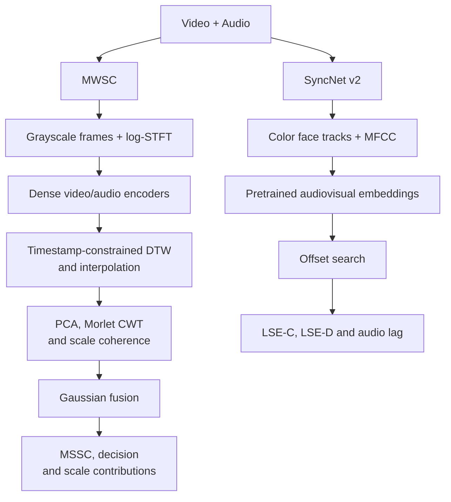

# MWSC: Multi-scale Wavelet Synchronization Coherence and Deep Learning for Deepfake Detection

MWSC detects temporal inconsistencies between speech and visual motion. Dense audio and video encoders produce feature sequences, which are aligned by presentation timestamps and compared through multi-scale wavelet coherence. A separate pretrained SyncNet branch reports lip-sync confidence, distance, and audio-video offset.

---

## Architecture



### Main Components

- Dense audiovisual encoders preserve temporal resolution. The compact architecture is the default; dense I3D and VGGish variants are also available.
- Timestamp-constrained DTW corrects sampling differences without warping away content mismatch.
- Morlet wavelets measure coherence at eight frequencies between 0.5 and 4 Hz.
- Gaussian-weighted coherence produces MSSC and per-frequency score contributions. `--explain` adds signed time-frequency terms that sum back to the same score. Detection supports frozen thresholds and stream-specific adaptive thresholds.
- SyncNet v2 provides an independent lip-sync score using its official pretrained weights.

---

## MWSC Equations and Code

MWSC represents agreement as a spectrum over physical motion frequencies. Dense learned features supply the observations; timestamp alignment preserves the measured timeline; the wavelet stage separates frequency-specific agreement before Gaussian fusion. Reports retain the scale contributions and boundary support of that decision. SyncNet supplies its independent embedding-distance and offset measurements.

### 1. Physical-Time Alignment and Principal Sequences

For timestamps $t_i^v$ and $t_j^a$, pairs outside the 0.05-second tolerance have infinite cost. The dynamic program in [core/align.py](core/align.py) computes

```math
D_{ij}=|t_i^v-t_j^a|+\min(D_{i-1,j-1},D_{i-1,j},D_{i,j-1}),
\qquad |t_i^v-t_j^a|\le 0.05.
```

Both dense streams are interpolated onto the supported 30Hz timeline. For each aligned feature matrix $H$, [first_component](core/wavelet.py) centers the features, chooses the first right singular vector, and standardizes its temporal projection:

```math
H_c=H-\bar H,\qquad H_c=U\Sigma R^T,\qquad
z=H_c r_1,\qquad x=z/\mathrm{std}_0(z).
```

The largest absolute loading fixes the component sign. Constant or nonfinite sequences are rejected before scoring.

### 2. Morlet Scales and Complex Coherence

The implementation uses eight frequencies from 0.5 to 4Hz, $F_s=30$Hz, and $\omega_0=6$. The corrected Morlet kernel and implemented sample-domain scales are

```math
\psi(u)=\pi^{-1/4}e^{-u^2/2}\left(e^{i\omega_0u}-e^{-\omega_0^2/2}\right),
\qquad s_j=\frac{\omega_0 F_s}{2\pi f_j}.
```

[morlet_cwt](core/wavelet.py) reflects each sequence at its boundaries and evaluates the discrete correlation through FFT convolution, using kernel radius $\lceil4s_j\rceil$:

```math
W_x(t,s_j)=\frac{1}{\sqrt{s_j}}\sum_n x[n]\,\overline{\psi((n-t)/s_j)}.
```

Let $E_j^v=\sum_t|W_v(t,s_j)|^2$ and define $E_j^a$ similarly. [scale_coherence](core/wavelet.py) sums complex cross-products before taking the squared magnitude:

```math
\rho_j=\frac{\sum_t W_v(t,s_j)\overline{W_a(t,s_j)}}{\sqrt{E_j^v E_j^a}},
\qquad C_j=|\rho_j|^2\in[0,1].
```

Time-varying phase disagreement cancels inside the complex sum. A constant phase rotation leaves $C_j$ unchanged. The reported phase is $\arg\rho_j$; a numerically zero resultant has no defined phase. These phase statistics accompany the independent SyncNet lag estimate. The [wavelet guide](https://paos.colorado.edu/research/wavelets/bams_79_01_0061.pdf) and [cross-wavelet analysis](https://npg.copernicus.org/articles/11/561/2004/npg-11-561-2004.pdf) explain complex products, phase, and boundary effects. MWSC uses the window-aggregated formula above.

### 3. Gaussian Fusion and Exact Score Contributions

[gaussian_weights](core/wavelet.py) evaluates the frequency weights with $\mu=4$Hz and $\sigma=1.5$Hz:

```math
w_j=\frac{e^{-(f_j-\mu)^2/(2\sigma^2)}}{\sigma\sqrt{2\pi}},\qquad
m_j=w_jC_j,\qquad
\mathrm{MSSC}=\sum_jm_j,\qquad
\widehat M=\frac{\mathrm{MSSC}}{\sum_jw_j}.
```

The raw score lies between zero and the discrete weight sum; the normalized score lies in $[0,1]$. Every score includes `scale_contributions` and `normalized_synchronization_score`. Normalized weight mode divides the Gaussian weights by their sum before fusion.

For explanations, define the normalized cross-product at each observed time and allocate its agreement with the full-window resultant:

```math
q_j(t)=\frac{W_v(t,s_j)\overline{W_a(t,s_j)}}{\sqrt{E_j^v E_j^a}},\qquad
\rho_j=\sum_tq_j(t),\qquad
e_j(t)=w_j\Re\left(q_j(t)\overline{\rho_j}\right).
```

The conservation identities follow directly from the same complex sum:

```math
\sum_t e_j(t)=w_j\Re(\rho_j\overline{\rho_j})=m_j,
\qquad\sum_{j,t}e_j(t)=\mathrm{MSSC}.
```

[coherence_evidence](core/wavelet.py) implements these signed contributions with the scorer's floating-point clipping convention. Positive terms reinforce the observed agreement; negative terms oppose it. The terms are score contributions rather than probabilities. `--explain` adds the full frequency-by-time matrix, its temporal sum, complex phases, and reconstruction error. [score_features](engine/detect.py) attaches the physical `time_seconds` grid. The `interior_support_mask` marks samples at least $\sqrt{2}s_j$ from both boundaries. It describes support without changing the scored window.

```bash
python -B main.py demo --explain
python -B main.py score --features ../runtime/mwsc/features.npz --no-update --explain --output ../runtime/mwsc/explained.json
python -B main.py predict --video ../videos/person.mp4 --checkpoint ../runtime/mwsc/experiments/seed42/encoders.pt --no-update --explain --output ../runtime/mwsc/prediction.json
```

The full matrix is exported only with `--explain`; normal reports retain the compact per-scale contributions. Explanation leaves the score, decision, and threshold update rule unchanged.

### 4. Training Objective and Decision Rule

[engine/loss.py](engine/loss.py) trains the encoders on real pairs with normalized similarities $Z_{ij}=\langle\bar v_i,\bar a_j\rangle/0.1$. For flattened positions $i=b_iT+t_i$, nearby off-diagonal positions from the same clip, within four frames, are masked. With matching-position targets $y_i=i$, define

```math
\widetilde Z_{ij}=\begin{cases}
-10000,&b_i=b_j,\quad 0<|t_i-t_j|\le4,\\
Z_{ij},&\mathrm{otherwise}.
\end{cases}
```

The exact objective is

```math
\mathcal L=\frac{\mathrm{CE}(\widetilde Z,y)+\mathrm{CE}(\widetilde Z^T,y)}{2}
+1-\frac{1}{BT}\sum_i\langle\bar v_i,\bar a_i\rangle
+\frac{1}{2D}\sum_{m\in\{v,a\}}\sum_d\max(0,0.5-s_d^m),
\qquad s_d^m=\sqrt{\mathrm{Var}_{b,t}(H_d^m)+10^{-4}}.
```

The real-only training and validation-selection protocol is related to [AVH-Align](https://openaccess.thecvf.com/content/CVPR2025/papers/Smeu_Circumventing_Shortcuts_in_Audio-visual_Deepfake_Detection_Datasets_with_Unsupervised_Learning_CVPR_2025_paper.pdf). MWSC's final decision uses its Gaussian-weighted wavelet score. [core/threshold.py](core/threshold.py) classifies a segment as fake when $\mathrm{MSSC}<T$. Accepted real scores enter history $H$, and the next adaptive threshold is

```math
T^*=\mathrm{mean}(H)-2\,\mathrm{std}_0(H),\qquad
T_{\mathrm{next}}=0.9T+0.1T^*.
```

Equality is real. `--no-update` freezes history and threshold; evaluation resets state between videos. A video is fake when any valid segment is fake and real only when every requested segment is valid and real.

## Project Structure

```text
MWSC/
├── core/                   # Signal processing, alignment, media, and face crops
│   ├── align.py
│   ├── audio.py
│   ├── face.py
│   ├── media.py
│   ├── threshold.py
│   └── wavelet.py
├── model/                  # Dense encoders and pretrained SyncNet
│   ├── encoder.py
│   ├── expert.py
│   ├── extract.py
│   ├── sound.py
│   ├── vision.py
│   └── weights.py
├── dataset/                # Dataset import, identity splits, and real-pair sampling
│   ├── adapter.py
│   ├── manifest.py
│   ├── samples.py
│   ├── speech.py
│   └── split.py
├── engine/                 # Training, inference, evaluation, and DDP
│   ├── detect.py
│   ├── evaluate.py
│   ├── lipsync.py
│   ├── loss.py
│   ├── parallel.py
│   ├── stream.py
│   ├── sync.py
│   └── train.py
├── support/
│   ├── download.py
│   ├── metrics.py
│   └── storage.py
├── verify/                 # Unit and integration tests
├── catalog.py              # Dataset references
├── check.py
├── config.py
├── install.py
├── main.py                 # Command-line interface
├── notes.py
├── run.py                  # Four-seed distributed training
└── README.md
```

---

## Requirements

| Dependency | Version / use |
| --- | --- |
| Python | 3.10 or newer |
| PyTorch | 2.2 or newer; CUDA build with NCCL for multi-GPU training |
| NumPy | 1.26 or newer |
| SciPy | 1.11 or newer |
| OpenCV | 4.8 or newer; Haar detection requires OpenCV 4.x or OpenCV 5 contrib |
| PyAV | 12 or newer for container audio and presentation timestamps |
| FFmpeg + FFprobe | Alternative container decoder when PyAV is unavailable |

### Installation

```bash
git clone https://github.com/wlz05/MWSC.git
cd MWSC
python -B install.py --install --lipsync
python -B main.py doctor
```

Install the CUDA build of PyTorch for the training machine using the [official installation selector](https://pytorch.org/get-started/locally/). The two-GPU training configuration uses Linux and NCCL.

---

## Pretrained Models

### SyncNet v2

```bash
python -B main.py fetch --example-output ../runtime/mwsc/example.avi
```

The official model is downloaded from Oxford and saved to `../runtime/mwsc/syncnet.model`. Downloads are validated before replacing the temporary file. An alternative local model can be supplied with `--syncnet-weights`.

Keep the relative `../runtime/mwsc` directory with the project when moving the workspace. Model files, feature archives, and experiment outputs use the supplied relative paths.

### MWSC Encoders

Train the encoders on real audiovisual pairs before running MWSC detection. The SyncNet checkpoint and the MWSC checkpoint serve different networks. Optional I3D/VGGish backbone checkpoints must match the dense architecture's expected tensor names and shapes.

---

## Quick Start

### Lip-sync Scoring

Score the official face-cropped example:

```bash
python -B main.py lipsync --video ../runtime/mwsc/example.avi --face-cropped --device cpu --output ../runtime/mwsc/example.json
```

Score a talking-head video with automatic single-face detection:

```bash
python -B main.py lipsync --video ../videos/person.mp4 --output ../runtime/mwsc/person.json
```

Select a face manually when several people are visible:

```bash
python -B main.py lipsync --video ../videos/person.mp4 --face-box 200 100 450 400 --output ../runtime/mwsc/person.json
```

The box is expressed as `left top right bottom` in the original frame. Use `--face-cropped` only for videos that have already been cropped around a face. External WAV input is supported with `--audio`; `--audio-offset` specifies its physical start on the video timeline.

### MWSC Detection with SyncNet Scores

```bash
python -B main.py predict --video ../videos/person.mp4 --checkpoint ../runtime/mwsc/experiments/seed42/encoders.pt --no-update --lipsync --output ../runtime/mwsc/prediction.json
```

The report contains the MWSC decision and video-level scores under `scores`, with SyncNet measurements under `lip_sync`.

| Field | Meaning |
| --- | --- |
| `scores.mwsc_mean` | Mean MSSC over valid windows |
| `scores.mwsc_min` | Minimum MSSC over valid windows |
| `scores.mwsc_normalized_mean` | Mean MSSC divided by the configured Gaussian weight sum |
| `lip_sync.lse_c` | SyncNet confidence; higher is better |
| `lip_sync.lse_d` | Minimum embedding distance; lower is better |
| `lip_sync.zero_offset_distance` | Distance at the original audio-video alignment |
| `lip_sync.audio_lag_ms` | Positive: audio lags video; negative: audio leads video |
| `lip_sync.coverage` | Fraction of requested time covered by scored face tracks |

LSE-C measures the strength of the best offset match. A delayed clip can still have high confidence, so inspect the estimated lag as well. These scores are not fake probabilities. Missing evidence produces `null` scores and a reason.

---

## Dataset Preparation

| Dataset | Adapter | Task and annotations |
| --- | --- | --- |
| [FakeAVCeleb](https://github.com/DASH-Lab/FakeAVCeleb) | `fakeavceleb` | Real/real, real/fake, fake/real, and fake/fake video-audio combinations for audiovisual deepfake detection |
| [LAV-DF](https://github.com/ControlNet/LAV-DF) | `lavdf` | Local manipulation detection with fake intervals and audio/video modification flags |
| [AV-Deepfake1M](https://github.com/ControlNet/AV-Deepfake1M) | `avdeepfake1m` | Audiovisual manipulation detection and localization with modality-specific intervals |
| [DFDC](https://ai.meta.com/datasets/dfdc/) | `dfdc` | Cross-dataset visual manipulation testing; original-video metadata links derivatives |
| [LRS2](https://www.robots.ox.ac.uk/~vgg/data/lip_reading/lrs2.html) | `lrs2` | Real speech pairs for encoder training and controlled audio-offset tests |
| [LRS3](https://arxiv.org/abs/1809.00496) | `lrs3` | TED/TEDx speech pairs for encoder training and cross-domain synchronization tests |
| [VoxCeleb2](https://www.robots.ox.ac.uk/~vgg/data/voxceleb/vox2.html) | `voxceleb2` | Real audiovisual speaker clips for representation training and identity-based splits |
| Custom CSV | `custom` | User datasets with authenticity labels, local intervals, and independent synchronization labels |

Encoder training selects real audiovisual pairs from the training split. FakeAVCeleb, LAV-DF, AV-Deepfake1M, and DFDC supply manipulation labels for detection evaluation. LRS2, LRS3, and VoxCeleb2 supply real speech clips for representation training and controlled synchronization tests. Controlled offsets use independently verified synchronized real clips.

The SyncNet scores in the example table use the [official SyncNet demonstration video](https://www.robots.ox.ac.uk/~vgg/software/lipsync/data/example.avi).

Example preparation using the released LAV-DF partition:

```bash
python -B main.py import --dataset lavdf --root ../datasets/lavdf --metadata ../datasets/lavdf/metadata.min.json --output ../runtime/mwsc/imported.csv
python -B main.py split --manifest ../runtime/mwsc/imported.csv --output ../runtime/mwsc/split.csv --keep-official
python -B main.py audit --manifest ../runtime/mwsc/split.csv --check-files --decode
```

### Other Dataset Imports

```bash
python -B main.py import --dataset lavdf --root ../datasets/lavdf --metadata ../datasets/lavdf/metadata.min.json --output ../runtime/mwsc/lavdf.csv
python -B main.py import --dataset avdeepfake1m --root ../datasets/avdeepfake1m --metadata ../datasets/avdeepfake1m/train_metadata.json ../datasets/avdeepfake1m/val_metadata.json --output ../runtime/mwsc/avdeepfake1m.csv
python -B main.py import --dataset dfdc --root ../datasets/dfdc/parta --metadata ../datasets/dfdc/parta/metadata.json --output ../runtime/mwsc/dfdc.csv
python -B main.py import --dataset lrs2 --root ../datasets/lrs2/main --filelist ../datasets/lrs2/train.txt --subset train --output ../runtime/mwsc/lrs2_train.csv
python -B main.py import --dataset lrs3 --root ../datasets/lrs3/trainval --subset train --output ../runtime/mwsc/lrs3_train.csv
python -B main.py import --dataset voxceleb2 --root ../datasets/voxceleb2 --output ../runtime/mwsc/voxceleb2.csv
python -B main.py import --dataset custom --metadata ../datasets/custom/manifest.csv --output ../runtime/mwsc/custom.csv
```

Metadata paths refer to local dataset files. Speech file-list entries are relative to `--root`; `--audio-root` pairs video entries with WAV files in a parallel directory. Import each speech subset separately with its `--subset`, then merge the CSV files through `--dataset custom --metadata`.

Supplied split labels are preserved by default. `--keep-official` explicitly selects this behavior; `--regroup` requests a custom grouped partition. Use `--identity-map` with a `source,group` CSV when subject IDs are stored separately. For joint experiments over related datasets, map original speaker IDs into one `--identity-namespace` and original video IDs into one `--source-namespace`.

### 1. Data Partitions

| Dataset | Partition protocol | Source |
| --- | --- | --- |
| LAV-DF | Preserve every `split` value in `metadata.min.json`; map the released `dev` name to `val` | [Official data preparation](https://github.com/ControlNet/LAV-DF#data-preparation) |
| AV-Deepfake1M | Preserve `train_metadata.json`, `val_metadata.json`, and the separate `test_files.txt` list; media reside under their subset directory | [Official SDK loader](https://github.com/ControlNet/AV-Deepfake1M/blob/master/python/avdeepfake1m/loader.py) |
| LRS2 | Import `train.txt`, `val.txt`, and `test.txt` separately; retain the broadcast-date partition | [Official LRS2 release](https://www.robots.ox.ac.uk/~vgg/data/lip_reading/lrs2.html) |
| LRS3 | Retain the released `pretrain`, `trainval`, and `test` subsets; training/validation selection follows the chosen experiment's supplied manifest | [LRS3 paper](https://arxiv.org/abs/1809.00496) |
| VoxCeleb2 | Retain the released development/test roles; supply the experiment's development training/validation manifest | [Official release](https://www.robots.ox.ac.uk/~vgg/data/voxceleb/vox2.html) |
| FakeAVCeleb | Preserve the evaluation metadata and category selection used by the baseline; for the AVH-Align comparison, use its real AV-Deepfake1M training/validation data and evaluate FakeAVCeleb as the external benchmark | [AVH-Align protocol](https://github.com/bit-ml/AVH-Align#data) |
| DFDC | Retain the selected benchmark's supplied subsets and original-video links | [Dataset release](https://ai.meta.com/datasets/dfdc/) |

The main workflow above uses LAV-DF's released three-way partition. AV-Deepfake1M imports its public training/validation annotations directly. Its held-out test videos follow `test_files.txt`; generate predictions with the selected checkpoint and submit them through the [official evaluation protocol](https://github.com/ControlNet/AV-Deepfake1M#sdk). Local validation reports retain the `val` name.

For a baseline-provided CSV, preserve its assignments when converting columns to the manifest format below and import it with `--dataset custom`. Set its `dataset` field to the benchmark name and retain original person/video IDs. The real-only training and validation-loss selection stages follow the roles used in [AVH-Align's training code](https://github.com/bit-ml/AVH-Align/blob/main/train.py); MWSC supplies its own encoders and temporal contrastive objective.

### 2. Decoding and Feature Caches

Prepare the manifest first. During training, decode the selected clip, convert audio to mono 16 kHz, and prepare video/audio tensors on demand. Duration caching is local to each dataset object. Training generates crops from training rows; validation uses deterministic center crops. Fixed decoder settings and normalization are shared across subsets.

For repeated inference, `main.py extract` stores one video's features in a separate NPZ archive with timestamps, preprocessing configuration, and checkpoint hash. Create feature archives with the selected checkpoint and keep train/validation/test outputs in separate directories. `main.py score` reads the archive's recorded configuration and model identity.

### Manifest Format

```csv
dataset,video,audio,label,group,source,split,duration,audio_offset,fake_segments,sync_label,offset_seconds
custom,../datasets/custom/real.mp4,,0,alice,clip001,train,4,0,[],0,0
custom,../datasets/custom/fake.mp4,,1,bob,clip002,test,4,0,"[[1.0,2.0]]",,
```

Paths are relative to the command's working directory. Labels use `0 = real` and `1 = fake`. Optional `audio_segments` and `video_segments` preserve modality-specific intervals; their union contributes to `fake_segments`.

`group` identifies people, while `source` links derivatives of the same original video. Splitting keeps connected identities and original sources together. Shared audio files, resolved media paths, and existing hard-link aliases join the same component across dataset namespaces. Supply an identity map when the source metadata only identifies video families. `identity_namespace` and `source_namespace` link IDs across related datasets.

Synchronization truth is separate from authenticity: `sync_label` is `0 = synchronized`, `1 = asynchronous`, or empty when unknown. `offset_seconds` is a measured audio lag. A real label alone does not establish synchronization.

---

## Training

### 3. Training Samples

Select real audiovisual pairs from `train`. Each epoch changes the training crop and shuffle order using the training seed. Temporally matching video/audio embeddings form positive pairs; other eligible temporal positions form the rank-local contrastive negatives. Validation draws real pairs from `val` with fixed crops and disabled gradients. All four training seeds use the same manifest.

### Experiment Configuration

Our experiment configuration uses **2 NVIDIA RTX 4090 GPUs, 24GB per GPU, and two 200GB SSDs**. The training seeds are **42, 52, 3047, 3407**. Released partitions stay fixed across all four runs. Custom grouped experiments use split seed 42.

| Setting | Value |
| --- | --- |
| GPUs | 2 × NVIDIA RTX 4090, 24GB per GPU |
| Storage | 2 × 200GB SSDs; data and runtime roots inspected separately |
| Training seeds | 42, 52, 3047, 3407 |
| Partition | Released metadata; seed 42 for custom grouped experiments |
| Distributed training | One DDP process per GPU, NCCL |
| Per-GPU batch size | 2 |
| Global batch size | 4 |
| Learning rate | 0.0001 |
| Optimizer | AdamW |
| Epochs per seed | 20 |

```bash
export CUDA_VISIBLE_DEVICES=0,1
python -B run.py --manifest ../runtime/mwsc/split.csv --devices 2 --seeds 42 52 3047 3407 --epochs 20 --batch-size 2 --workers 2 --evaluate
```

The default seed grid is **42, 52, 3047, 3407**. Each seed uses both GPUs through one DDP process per GPU. Seeds run sequentially, with separate checkpoints:

```text
../runtime/mwsc/experiments/
├── seed42/encoders.pt
├── seed52/encoders.pt
├── seed3047/encoders.pt
└── seed3407/encoders.pt
```

`--batch-size` and `--workers` are per process. Batch size 2 on two devices gives a global batch size of 4; workers 2 creates four data-loading workers. Contrastive negatives are local to each rank. Validation samples are sharded without padding, and losses are reduced by sample count. Only rank zero writes the checkpoint.

With `--evaluate`, each selected checkpoint is calibrated on real validation videos and evaluated on the fixed test partition. Every seed directory contains `calibration.json`, `test.json`, and `result.json`; `../runtime/mwsc/experiments/summary.json` stores the individual results in `byseed` and each metric's mean and sample standard deviation in `metrics`. The final mean is `(score42 + score52 + score3047 + score3407) / 4`, using four independent seed-level metrics with equal weight. Sample standard deviation uses denominator three. Predictions and windows are not pooled across seeds before metric calculation. Missing seed reports prevent aggregation, and a metric undefined for any seed remains undefined. Empty reports, nonnumeric metrics, and colliding metric paths are rejected before summary publication. The manifest hash, test video identities, and encoder configuration must match across seeds. Without `--evaluate`, the launcher performs training only.

To evaluate an existing four-seed checkpoint set without retraining:

```bash
python -B run.py --manifest ../runtime/mwsc/split.csv --seeds 42 52 3047 3407 --evaluate-only
```

Preview the launch commands:

```bash
python -B run.py --manifest ../runtime/mwsc/split.csv --devices 2 --dry-run
```

### One Seed with torchrun

```bash
torchrun --standalone --nproc-per-node=2 main.py train --manifest ../runtime/mwsc/split.csv --checkpoint ../runtime/mwsc/experiments/seed42/encoders.pt --seed 42 --epochs 20 --batch-size 2 --workers 2 --device cuda
```

### Single GPU

```bash
python -B main.py train --manifest ../runtime/mwsc/split.csv --checkpoint ../runtime/mwsc/experiments/seed42/encoders.pt --seed 42 --epochs 20 --batch-size 2 --device cuda:0
```

### Dense I3D / VGGish

```bash
python -B run.py --manifest ../runtime/mwsc/split.csv --devices 2 --architecture i3d_vggish --batch-size 1 --video-backbone ../weights/i3d.pt --audio-backbone ../weights/vggish.pt
```

The dense variants retain temporal resolution. Start with batch size 1 per device and measure memory use before increasing it. Resume a trained MWSC checkpoint through `main.py train --resume`.

### 4. Validation and Model Selection

After each training epoch, compute validation contrastive loss in evaluation mode. Average loss by the number of examples and save the checkpoint with the lowest validation loss. DDP validation shards cover each validation example once. Checkpoints record the training/validation annotations, partition signature, seed, optimizer, and selected validation loss. Resume requires the same training seed and annotations and carries forward the selected loss and weights. Pass the checkpoint's original seed with `--seed`; a missing or different recorded seed stops recovery before an epoch runs.

The [AVH-Align training loop](https://github.com/bit-ml/AVH-Align/blob/main/train.py) likewise separates optimization and validation and selects by validation loss. For a cross-dataset comparison, train and select on the source benchmark, then retain the target benchmark's evaluation membership.

### Arguments

| Argument | Default | Description |
| --- | --- | --- |
| `--devices` | `2` | Processes/devices per seed in `run.py` |
| `--minimum-free-gb` | `5` | Free-space reserve checked before each training/evaluation process |
| `--seeds` | `42 52 3047 3407` | Training seeds in `run.py` |
| `--epochs` | `20` | Epochs per seed in `run.py` |
| `--batch-size` | `2` | Samples per process |
| `--workers` | `2` | Loading workers per process in `run.py` |
| `--learning-rate` | `0.0001` | AdamW learning rate |
| `--architecture` | `compact` | `compact` or `i3d_vggish` |
| `--image-size` | `224` | Video encoder input size |
| `--maximum-steps` | unset | Optional limit per epoch for a short run |
| `--config` | unset | Relative JSON configuration |

---

## Evaluation

### 5. Threshold Calibration and Final Test

Load the selected checkpoint. Compute the operating threshold from real `val` videos and save the validation annotations, model hash, and scoring configuration with the calibration result. Freeze the model and threshold, reset history for each video, and evaluate the complete `test` subset. Training and validation memberships recorded in the checkpoint accompany this final evaluation. Run the same calibration/testing sequence separately for all four seeds.

Detection evaluation reports ROC-AUC, EER, accuracy, precision, recall, and F1. Temporal localization reports window proposal AP at IoU thresholds 0.3, 0.5, and 0.7. Synchronization evaluation reports offset error and synchronization classification separately.

Lip-sync evaluation uses [SyncNet's LSE-C and LSE-D](https://github.com/joonson/syncnet_python), also used in [AVGen-Bench](https://github.com/microsoft/AVGen-Bench). MSSC measures multi-scale audiovisual coherence within MWSC.

| Metric | Task | Direction |
| --- | --- | --- |
| ROC-AUC / F1 | Video and window authenticity classification | Higher |
| EER | Authenticity classification | Lower |
| Window proposal AP | Temporal manipulation localization | Higher |
| MSSC | Multi-scale audiovisual coherence | Higher agreement |
| LSE-C | Lip-sync confidence over candidate offsets | Higher |
| LSE-D | Minimum audiovisual embedding distance | Lower |
| Offset MAE | Audio-video delay estimation | Lower |

Calibrate the threshold on real validation videos, then evaluate the test split:

```bash
python -B main.py calibrate --manifest ../runtime/mwsc/split.csv --checkpoint ../runtime/mwsc/experiments/seed42/encoders.pt --output ../runtime/mwsc/experiments/seed42/calibration.json
python -B main.py evaluate --manifest ../runtime/mwsc/split.csv --checkpoint ../runtime/mwsc/experiments/seed42/encoders.pt --config ../runtime/mwsc/experiments/seed42/calibration.json --split test --output ../runtime/mwsc/experiments/seed42/test.json
```

Repeat calibration and evaluation for each seed. Compare mean and standard deviation across the four test runs. Calibration uses validation data only; it is bound to the checkpoint hash.

### Audio-Video Offset Tests

For manually verified synchronized real videos:

```bash
python -B main.py sync --manifest ../runtime/mwsc/verified.csv --checkpoint ../runtime/mwsc/experiments/seed42/encoders.pt --offsets -0.3 -0.2 -0.1 0 0.1 0.2 0.3 --output ../runtime/mwsc/offsets.json
```

The controlled-offset interface crops unsupported edges and preserves authenticity labels. It reports offset error and synchronization classification separately from deepfake classification.

### Default Scoring Parameters

| Parameter | MWSC | SyncNet |
| --- | --- | --- |
| Video sampling | 30 fps, grayscale | 25 fps, BGR face crops |
| Audio | 16 kHz mono, log-STFT | 16 kHz mono, 13-coefficient MFCC |
| Window | 2 seconds, 50% overlap | 5 seconds by default |
| Representation | Dense features, per-modality PCA | Pretrained 1024-dimensional embeddings |
| Comparison | Morlet coherence at 0.5–4 Hz | Euclidean distance over ±15 frames |

MSSC uses the raw Gaussian weights by default. Their sum is approximately 1.121, so MSSC can exceed 1. Normalized Gaussian weights are available through the configuration. Thresholds must be recalibrated when the scoring grid or weight mode changes.

---

### SSD Layout and Runtime Checks

The two SSDs provide 400GB of nominal capacity across two devices. Keep source videos, audio, and manifests on the data SSD; use the runtime SSD for checkpoints, extracted feature archives, threshold states, and reports. Retain relative paths in manifests and command arguments. `--checkpoint-root` routes experiment outputs, and `extract --output` selects the feature-archive destination.

```bash
python -B main.py doctor --data-root ../datasets --runtime-root ../runtime/mwsc --minimum-free-gb 5
python -B run.py --manifest ../runtime/mwsc/split.csv --checkpoint-root ../runtime/mwsc/experiments --minimum-free-gb 5 --devices 2 --dry-run
```

`doctor` reports the configured two-4090/two-SSD profile separately from detected GPU names, actual filesystem capacities, and free space. It reports whether the two supplied roots belong to distinct filesystems. A missing root is inspected through its nearest existing parent and marked `exists=false`. Create the intended mount/directory layout before interpreting that root as an SSD. The launcher checks the checkpoint filesystem's reserve before every training, calibration, and testing process; `--minimum-free-gb` controls that reserve. Dataset sizes and extracted archives must fit the capacity reported for their actual filesystem.

CUDA loaders use pinned host memory, and input copies request nonblocking transfer. Epoch workers restart so each worker receives the current crop epoch. Training remains FP32, with batch size 2 per GPU and rank-local contrastive negatives. Four seeds run sequentially, each using the same two-GPU allocation.

## Tests

```bash
python -B main.py test
python -B check.py
python -B main.py demo
```

The tests cover signal equations, dataset splits, training/inference, synchronization offsets, pretrained model compatibility, distributed data sharding, seed-report validation, and recovery seed identity. JSON inputs reject duplicate fields, nonfinite numbers, and floating-point overflow; UTF-8 BOM input remains supported.

Cropping and windowing define the scoring protocol. The face pipeline uses Haar detection, a supplied face box, or a precropped track. Each report records its preprocessing mode and model hash.

---

## References

- [Method description: CN122413017A](https://eureka.patsnap.com/patent/CN122413017A)
- [SyncNet: Out of time: automated lip sync in the wild](https://github.com/joonson/syncnet_python)
- [Wav2Lip evaluation](https://github.com/Rudrabha/Wav2Lip/tree/master/evaluation)
- [FakeAVCeleb](https://github.com/DASH-Lab/FakeAVCeleb)
- [LAV-DF](https://github.com/ControlNet/LAV-DF)
- [AV-Deepfake1M](https://github.com/ControlNet/AV-Deepfake1M)
- [AVH-Align](https://github.com/bit-ml/AVH-Align)
- [AVGen-Bench](https://github.com/microsoft/AVGen-Bench)
- [LRS2](https://www.robots.ox.ac.uk/~vgg/data/lip_reading/lrs2.html)
- [LRS3: a large-scale dataset for visual speech recognition](https://arxiv.org/abs/1809.00496)
- [VoxCeleb2](https://www.robots.ox.ac.uk/~vgg/data/voxceleb/vox2.html)
- [DFDC](https://ai.meta.com/datasets/dfdc/)

## Third-party License

The SyncNet-compatible network definitions retain Joon Son Chung's MIT license. Pretrained weights follow the terms on the [Oxford download page](https://www.robots.ox.ac.uk/~vgg/software/lipsync/).

```text
Copyright (c) 2016-present Joon Son Chung.
Permission is hereby granted, free of charge, to any person obtaining a copy
of this software and associated documentation files (the "Software"), to deal
in the Software without restriction, including without limitation the rights
to use, copy, modify, merge, publish, distribute, sublicense, and/or sell
copies of the Software, and to permit persons to whom the Software is
furnished to do so, subject to the following conditions:
The above copyright notice and this permission notice shall be included in
all copies or substantial portions of the Software.
THE SOFTWARE IS PROVIDED "AS IS", WITHOUT WARRANTY OF ANY KIND, EXPRESS OR
IMPLIED, INCLUDING BUT NOT LIMITED TO THE WARRANTIES OF MERCHANTABILITY,
FITNESS FOR A PARTICULAR PURPOSE AND NONINFRINGEMENT. IN NO EVENT SHALL THE
AUTHORS OR COPYRIGHT HOLDERS BE LIABLE FOR ANY CLAIM, DAMAGES OR OTHER
LIABILITY, WHETHER IN AN ACTION OF CONTRACT, TORT OR OTHERWISE, ARISING FROM,
OUT OF OR IN CONNECTION WITH THE SOFTWARE OR THE USE OR OTHER DEALINGS IN
THE SOFTWARE.
```
